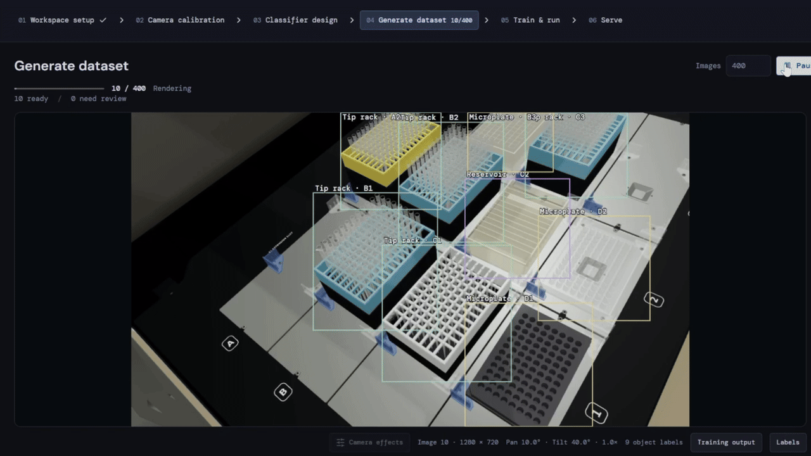

# Lab Sentry



Build custom vision models for your lab using synthetic images from a camera-matched 3D environment. Describe what you want to detect, generate labeled scenes, train a YOLO model, and run it against your camera.

Includes an Opentrons Flex deck setup with trained models for tip racks, microplates, reservoirs, and all 12 deck slots. View detections on a live 3D deck or read the state through REST and SSE.

## Get started

### Windows

1. Download the repository (**Code → Download ZIP**) and extract it.
2. Run **Setup.cmd**. It installs the dependencies and needs internet on first run.
3. Connect your OBSBOT by USB and close other apps using the camera.
4. Run **Start.cmd**. The app opens at [localhost:5173](http://127.0.0.1:5173/).
5. In **Open workspace**, choose **Flex deck – included setup**. Go to **Train & run**, select **Flex deck – ready to run**, and click **Run detection**.

Detection runs on CPU. No NVIDIA GPU or Codex login required. Keep the launcher open while using the app; press `Ctrl+C` to stop. After an update, stop the app and rerun **Setup.cmd**.

Tested on Windows 11 x64. If automatic dependency installation fails, install Node.js LTS, .NET 10 SDK, and uv, then rerun setup.

### macOS

Clone the repository and run these commands from its folder in Terminal:

```sh
tools/setup-mac.sh
tools/start-mac.sh
```

Connect the OBSBOT, close other camera apps, and allow Terminal camera access when prompted. Open the included workspace and run detection as above.

Tested on Apple silicon with an OBSBOT Tiny SE. Dependencies stay inside `.runtime/`. Training uses the Apple GPU through MPS.

## Use your own setup

Set up the scene, match the simulated camera to your real camera, then work with the copilot to define your detection task. Generate labeled images, review camera effects, and train a model. The copilot requires a Codex CLI login. See [training instructions](training/README.md) for GPU setup and validation.

The included model uses a fixed camera position and restores its saved pan, tilt, and zoom. A different mount needs its own calibration and model. Unknown slots are not empty slots. The bundled model was trained on synthetic images with one labeled real image for adaptation.

Export workspaces to move them between computers. **Model & validation → Download model** saves a model ZIP. Extract a trusted model export into `training/runs/<model-id>/`, restart the app, and import its `workspace.json`. Generated datasets and saved setups live in browser storage.

## State API

Open **Serve** to see the live deck and API response.

```text
GET http://127.0.0.1:5102/api/v1/deck-state
GET http://127.0.0.1:5102/api/v1/deck-state/stream
```

The first endpoint returns JSON; the second streams updates over SSE. Both report all 12 slots, including empty, occupied, obscured, and unknown states. Stale observations return unknown.

For Windows LAN access, run `training/start-lan.ps1`. See [API and network setup](training/README.md#live-state-rest-api) for details.

## Troubleshooting

- **No camera:** close other camera apps and check USB and camera permissions.
- **Setup fails or a port is busy:** stop the existing launcher and retry. Reopen Setup after installing missing tools.
- **View changed or unknown slots:** check camera placement and calibration.
- **Service fails:** check `.runtime/logs/`.

[Training and validation](training/README.md) · [Dependency and model licenses](THIRD_PARTY.md)
